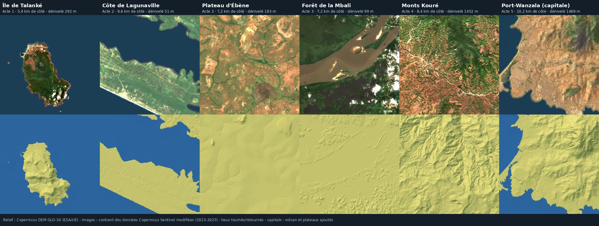

# Terrains

Terrains générés à partir de **données satellites réelles** avec
[../outils-geo/terrain_reel.py](../outils-geo/terrain_reel.py). Chaque lieu réel est tourné et/ou
retourné pour ne pas être reconnaissable.

| Dossier | Zone du jeu | Jumeau réel | Côté | Terres | Dénivelé | Import Unreal X = Y / Z | Altitude réelle du « 0 » |
|---|---|---|---|---|---|---|---|
| [ile-depart/](ile-depart/) | Île de Talanké (acte 1) | Île d'Annobón (Guinée équatoriale), réduite de moitié | 5,4 km | 5 km² | 292 m | 267,01 / 120 | niveau de la mer |
| [cote-lagunaville/](cote-lagunaville/) | Côte de Lagunaville (acte 2) | Cordon littoral et lagune Ébrié, vers Jacqueville (Côte d'Ivoire) | 9,6 km | 44 km² | 51 m | 476,19 / 21 | niveau de la mer |
| [plateau-ebene/](plateau-ebene/) | Plateau d'Ébène (acte 3) | Plateau de l'Adamaoua, région de Ngaoundéré (Cameroun) | 7,2 km | 52 km² | 183 m | 356,50 / 77 | 1 066 m |
| [foret-mbali/](foret-mbali/) | Forêt de la Mbali (acte 3) | Fleuve Ogooué, région de Lambaréné (Gabon) | 7,2 km | 52 km² | 99 m | 357,82 / 42 | 2 m |
| [monts-koure/](monts-koure/) | Monts Kouré (acte 4) | Monts Bamboutos (Cameroun) | 8,4 km | 70 km² | 1 452 m | 416,09 / 597 | 1 288 m |
| [port-wanzala/](port-wanzala/) | Port-Wanzala, capitale (acte 5) | Presqu'île de Freetown (Sierra Leone), en miroir et tournée de 160°, **+ volcan greffé (Pico Basilé, Bioko) + plateaux des Pyramides et du Palais** | 10,2 km | 80 km² (dont ~25 km² de plaine urbanisable) | 1 469 m | 505,90 / 603 (fichiers `port-wanzala-fictif_*`) | niveau de la mer |

Chaque dossier contient :

| Fichier | Usage |
|---|---|
| `*_heightmap_2017.png` | Relief 16 bits à importer dans Unreal (*Landscape → Import from File*) |
| `*_satellite.jpg` | Image satellite alignée : **guide** pour peindre végétation, routes, villages (pas une texture finale) |
| `*_apercu_relief.jpg` | Aperçu ombré du relief |
| `*_infos.json` | Échelles d'import, zone réelle, transformations, sources et mentions obligatoires |

## Version fictive de la capitale

Dans `port-wanzala/`, utiliser les fichiers **`port-wanzala-fictif_*`** (relief modifié et image
guide retouchée). Les éléments ajoutés sont décrits dans `elements_fictifs.json` et produits par
[../outils-geo/modifier_terrain.py](../outils-geo/modifier_terrain.py). Les fichiers
`port-wanzala_*` restent la base réelle, à garder pour pouvoir refaire les modifications.

## Limites à connaître

- **Le modèle Copernicus mesure la surface visible** : en forêt, c'est le haut des arbres, pas le
  sol. Le relief des zones boisées sera lissé (Gaea ou outils de sculpture d'Unreal) avant de
  planter la végétation du jeu.
- **Les lagunes et fleuves** sont plats dans le relief : on y place un plan d'eau Unreal
  (*Water* plugin). La profondeur de la lagune est fictive (à remodeler, la vraie fait 5 à 20 m).
- **Les surfaces dépassent le plan initial** (≈ 300 km² au total contre 120 km² prévus). On pourra
  réduire avec `--echelle` ou ne garder qu'une partie de chaque terrain ; décision à prendre au
  moment de construire chaque acte (l'île, seule nécessaire pour commencer, est à la bonne taille).

## Mentions obligatoires

Copernicus DEM GLO-30 : © DLR e.V. 2010-2014 et © Airbus Defence and Space GmbH 2014-2018, fourni
dans le cadre du programme Copernicus par l'ESA et l'Union européenne.
Contient des données Copernicus Sentinel modifiées (2023-2025).
